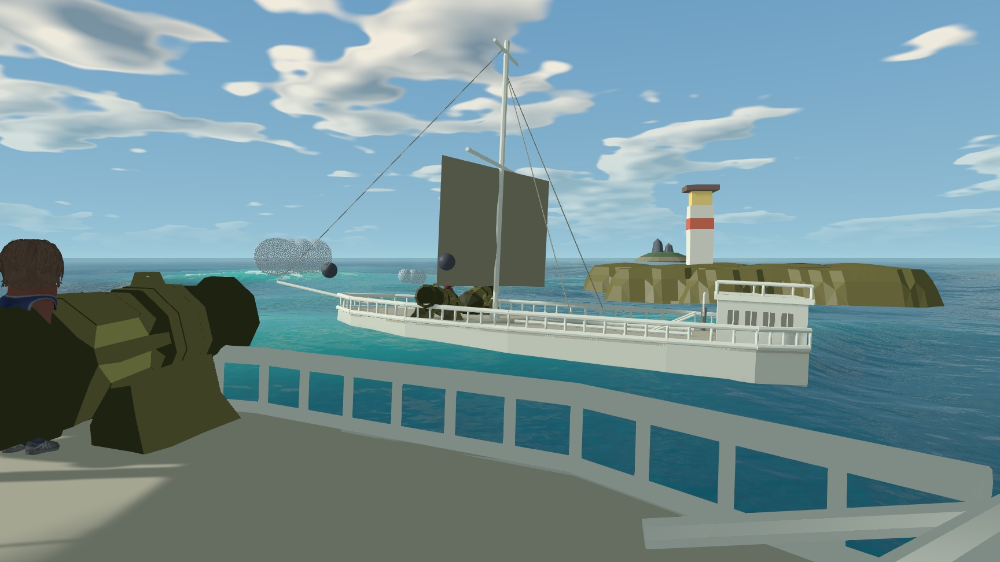
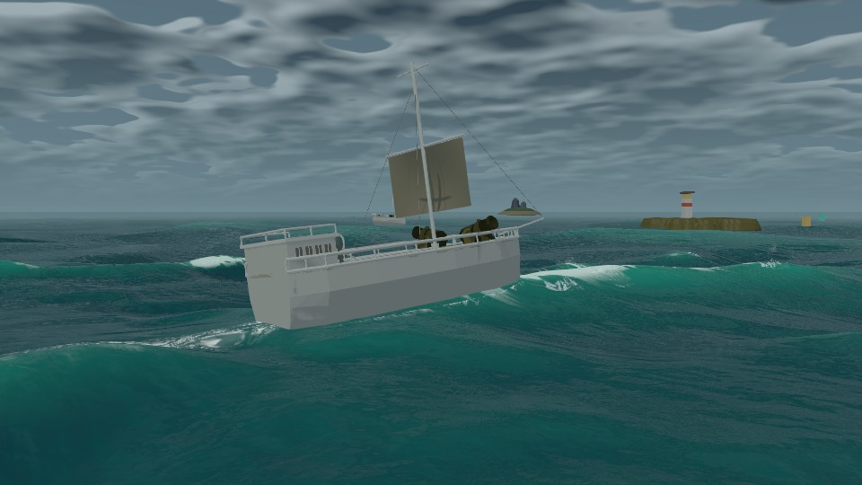
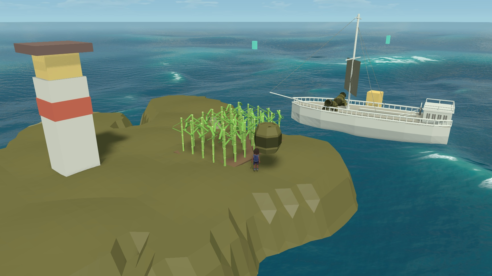
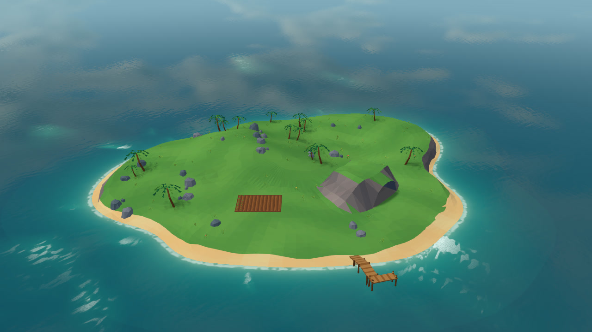
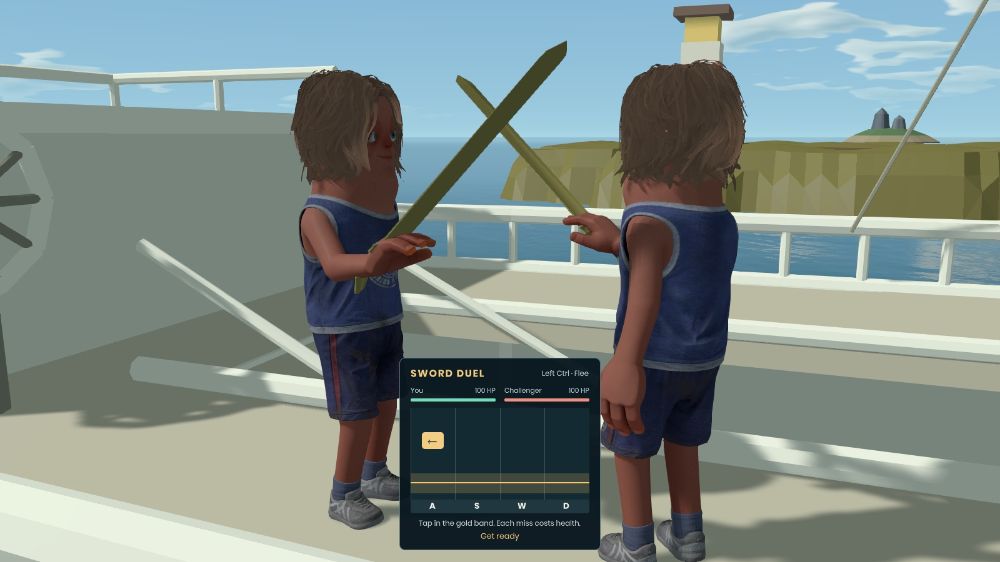

# Naval Combat

Catch the wind and haul sugar cane between island ports in this sailing game for s&box. Spend your earnings on better rigging and a bigger hold. When pirates open fire, aim a deck cannon or head below to patch leaks and bail water.

<table>
  <tr>
    <td width="50%"> <strong>Storm sailing</strong></td>
    <td width="50%"> <strong>The sugar cane trade</strong></td>
  </tr>
  <tr>
    <td> <strong>Farmer’s Bay</strong></td>
    <td> <strong>Sword duels</strong></td>
  </tr>
</table>
